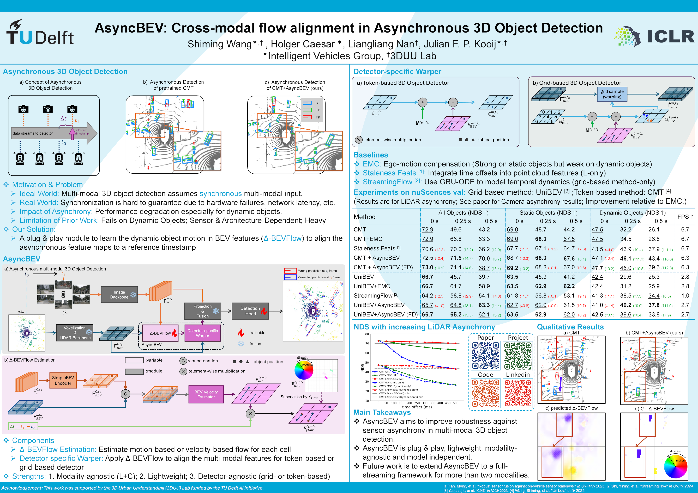

# AsyncBEV

**AsyncBEV: Cross-modal Flow Alignment in Asynchronous 3D Object Detection**

Shiming Wang, Holger Caesar, Liangliang Nan, and Julian F. P. Kooij

**ICLR 2026**

[](https://arxiv.org/abs/2601.12994)
[](assets/AsyncBEV_ICLR26_poster_resize.png)
[](https://tudelft-iv.github.io/AsyncBEV/)
[](https://proceedings.iclr.cc/paper_files/paper/2026/hash/2b31e6fdd87368cb1e838219deb153d3-Abstract-Conference.html)
[](https://huggingface.co/datasets/ShimingWang/AsyncBEV)

AsyncBEV aligns asynchronous camera and LiDAR features for 3D object detection. It estimates a dense BEV velocity field from the two modalities, uses their known time offset to obtain feature displacement, and compensates for object motion before detection.

This repository contains the **CMT implementation** of AsyncBEV: model components, asynchronous data loaders, configurations, and the custom evaluator. The paper also evaluates UniBEV; that implementation is not included here.

[](assets/AsyncBEV_ICLR26_poster_resize.png)

For code navigation and contributions with an AI assistant, read [AGENTS_public.md](AGENTS_public.md). Ask the assistant to read that guide before working; its custom filename is not automatically discovered by every tool.

[Installation](#installation) · [Data](#data-preparation) · [Configurations](#configurations-and-protocol) · [Checkpoints](#checkpoints) · [Evaluation](#evaluation) · [Training](#training) · [Results](#reported-cmt-results) · [Citation](#citation-and-acknowledgments)

## Release status

This checkout includes the CMT plugin, configurations, and reviewed training/evaluation entrypoints. It needs the MMDetection3D environment and external data/checkpoints described below.

- Model and configuration code: available under [`projects/CMT`](projects/CMT).
- Training, ordinary evaluation, and all/static/dynamic evaluation: available under [`tools/`](tools/README.md), with distributed launchers, a resolved-config inspector, and a training-log analyzer.
- AsyncBEV data supplements: **available** on [`ShimingWang/AsyncBEV`](https://huggingface.co/datasets/ShimingWang/AsyncBEV), released October 15, 2026. The verified release is pinned at revision [`b31cfeec498070875c4dfdd531e6aa167d5b229e`](https://huggingface.co/datasets/ShimingWang/AsyncBEV/tree/b31cfeec498070875c4dfdd531e6aa167d5b229e), with a dataset card, `manifest.json`, and `SHA256SUMS`.
- Trained AsyncBEV checkpoints: **available** through three public, read-only [SURFdrive download links](#checkpoints), with config mappings and SHA-256 checksums. No login or password is required. They are separate from the Hugging Face data release, which does not contain these weights.
- Camera/LiDAR GT flow generation and legacy `pts_in_boxes` repair have [portable CPU command-line tools](tools/data_converter/README.md). They reuse CMT geometry and consume the published custom maps; builders for those two maps are not included. Use the published supplements for existing experiments; generated labels have not been compared across the full release.

The commands below document how to assemble the code and run it once those assets are available. A fresh installation and experiment reproduction have not been run as part of this documentation update.

## Installation

Use Linux with a CUDA-capable NVIDIA GPU. Follow the versions specified by [CMT](https://github.com/junjie18/CMT#preparation):

| Dependency | Version |
| --- | --- |
| Python | 3.8 |
| CUDA toolkit | 11.1 |
| PyTorch | 1.9.0 |
| MMCV | `mmcv-full==1.6.0` |
| MMDetection | 2.24.0 |
| MMSegmentation | 0.29.1 |
| MMDetection3D | **1.0.0rc5** |
| NumPy | `<1.24` for legacy sampling aliases |
| YAPF | `0.40.1` for MMCV config formatting |
| spconv | `spconv-cu111==2.1.21` |
| FlashAttention | **0.2.2**; see the [bundled wheel](#bundled-flashattention-installer) for its separate binary compatibility requirements |

Do not substitute the current MMDetection3D/MMEngine stack: the plugin uses the older MMCV runner and MMDetection registries. Use the [MMDetection3D v1.0.0rc5 installation guide](https://github.com/open-mmlab/mmdetection3d/blob/v1.0.0rc5/docs/en/getting_started.md). CUDA extensions require a compatible compiler and CUDA toolkit; PyTorch's bundled CUDA runtime alone does not provide `nvcc`.

```bash
git clone https://github.com/tudelft-iv/AsyncBEV.git
cd AsyncBEV

conda create -n asyncbev python=3.8 -y
conda activate asyncbev

python -m pip install -c requirements/model-constraints.txt \
  torch==1.9.0+cu111 torchvision==0.10.0+cu111 \
  -f https://download.pytorch.org/whl/torch_stable.html
python -m pip install -c requirements/model-constraints.txt mmcv-full==1.6.0 \
  -f https://download.openmmlab.com/mmcv/dist/cu111/torch1.9.0/index.html
python -m pip install -c requirements/model-constraints.txt \
  mmdet==2.24.0 mmsegmentation==0.29.1
python -m pip install -c requirements/model-constraints.txt spconv-cu111==2.1.21

git clone --branch v1.0.0rc5 --depth 1 \
  https://github.com/open-mmlab/mmdetection3d.git mmdetection3d
python -m pip install -c requirements/model-constraints.txt -v -e ./mmdetection3d

python -m pip install -c requirements/model-constraints.txt \
  packaging ninja einops prettytable tensorboard wandb
python -m pip install -c requirements/model-constraints.txt \
  flash-attn==0.2.2 --no-build-isolation

export PYTHONPATH="$PWD${PYTHONPATH:+:$PYTHONPATH}"
```

Use the bundled `tools/` directly; no separate CMT tool download is needed. The training entrypoint imports the installed `mmdet3d` package, so an existing compatible installation can also be used without a nested checkout. These setup commands have not been executed as part of this update.

Keep [the model compatibility constraints](requirements/model-constraints.txt) when installing additional packages in this environment. Legacy sampling uses NumPy aliases removed in 1.24; MMCV 1.6.0's config formatter uses a YAPF argument removed in 0.40.2. These constraints address known incompatibilities, rather than locking every transitive dependency. The standalone CPU flow tools have their own dependency instructions.

The plugin imports FlashAttention directly. [FlashAttention 0.2.2](https://github.com/Dao-AILab/flash-attention/tree/v0.2.2) targets Turing/Ampere GPUs; do not assume this stack supports V100 or newer GPU architectures unchanged. The tracked CPython 3.7 voxel binary is not a Python 3.8 installation dependency; the active voxelization path uses spconv. Minimal Python installations may also need Tk because the current source imports `turtle` and `idlelib`.

### Bundled FlashAttention installer

**FlashAttention 0.2.2 is the pinned version for this repository**, matching the plugin's `flash_attn_unpadded_kvpacked_func` interface. A prebuilt installer is included at [`wheels/flash_attn-0.2.2+cu113torch1.11.0-cp38-cp38-linux_x86_64.whl`](wheels/flash_attn-0.2.2+cu113torch1.11.0-cp38-cp38-linux_x86_64.whl).

This wheel is labeled for **CPython 3.8, PyTorch 1.11.0, CUDA 11.3, and Linux x86_64**. Use it in a matching environment with `torch` and `einops` already installed:

```bash
# Run from the repository root in the matching PyTorch 1.11.0 / CUDA 11.3 environment.
(cd wheels && sha256sum -c SHA256SUMS)
python -m pip install --no-deps ./wheels/flash_attn-0.2.2+cu113torch1.11.0-cp38-cp38-linux_x86_64.whl
```

The upstream CMT installation example above uses **PyTorch 1.9.0 / CUDA 11.1**; keep its FlashAttention 0.2.2 source-build command for that environment instead of installing this wheel. The wheel's metadata, API compatibility, and file integrity were checked; a fresh installation or GPU execution was not performed when adding it. See [wheel details and checksum](wheels/README.md).

## Data preparation

Obtain nuScenes **v1.0-trainval**, including sensor samples, sweeps, metadata, and maps, from [nuScenes](https://www.nuscenes.org/nuscenes). Prepare the standard info files following the [versioned MMDetection3D nuScenes guide](https://github.com/open-mmlab/mmdetection3d/blob/v1.0.0rc5/docs/en/datasets/nuscenes_det.md) and [data-preparation guide](https://github.com/open-mmlab/mmdetection3d/blob/v1.0.0rc5/docs/en/data_preparation.md). CMT also links its prepared info files and image initialization weights in its [preparation instructions](https://github.com/junjie18/CMT#preparation).

The asynchronous configurations require additional sweep maps and flow labels. Standard MMDetection3D `create_data.py` does **not** generate these supplements. Arrange the files as follows:

```text
AsyncBEV/
├── projects/CMT/
├── tools/                         # Bundled training/evaluation utilities
├── mmdetection3d/                  # v1.0.0rc5
├── checkpoints/CMT/
│   └── voxel0075_vov_1600x640_epoch20.pth
└── data/nuscenes/                  # Can be a symlink
    ├── maps/
    ├── samples/
    ├── sweeps/
    ├── v1.0-trainval/
    ├── mmdet3d_cmt/
    │   ├── nuscenes_infos_train.pkl
    │   └── nuscenes_infos_val.pkl
    └── async_supplement/
        ├── lidar_sample_sweeps_map_w_extrin_ego_sample_ref_coord.pkl
        ├── cams_sample_sweeps_map_ego_sample_w_ego_pose_timestamp.pkl
        ├── async_lidar_flow/<sample_token>/<async_data_token>.pkl
        └── async_cam_flow/<sample_token>/<async_data_token>.pkl
```

For an existing installation, create `data/nuscenes` as a symlink to the prepared nuScenes root. Place or link `async_supplement` inside that root. The supplement directory alone is not the complete nuScenes dataset.

**Synchronous CMT training only:** [fusion/cmt.py](projects/CMT/configs/fusion/cmt.py) additionally uses `checkpoints/CMT/fcos3d_vovnet_imgbackbone-remapped.pth` from the upstream CMT preparation assets and `data/nuscenes/mmdet3d_cmt/nuscenes_dbinfos_train.pkl`. Its `UnifiedObjectSample` stage requires the matching GT database, including point crops and image crops referenced by each record's `path` and `image_path`, resolved under `data/nuscenes/mmdet3d_cmt/`. Standard LiDAR-only database preparation is insufficient for this image-sampling stage. The main AsyncBEV/FD training configs disable database sampling and initialize from the full synchronous CMT detector instead.

The Hugging Face distribution packages camera and LiDAR flow files into 512 independent `.tar.zst` archives under `archives/async_cam_flow/` and `archives/async_lidar_flow/`, grouped by the first two characters of each sample token. The four index/map files remain directly under `async_supplement/`. Follow the [dataset card at the verified release revision](https://huggingface.co/datasets/ShimingWang/AsyncBEV/blob/b31cfeec498070875c4dfdd531e6aa167d5b229e/README.md) to download, verify `SHA256SUMS`, and extract the archives into your nuScenes root; archive paths already begin with `async_supplement/`. Pin that revision when downloading and record it for reproducibility. The download payload is approximately 185 GB; the extracted supplement contains 593,493 files totaling approximately 540 GB, in addition to the original nuScenes data.

Use info files and sweep maps with matching stored paths. The loaders look up filenames in the maps and open the stored sensor paths directly. Changing only the top-level `data_root` through `--cfg-options` does not update paths already constructed inside the config; use the expected directory layout or edit all relevant paths before loading the config.

**Flow labels are currently required for evaluation as well as training:** the released asynchronous test pipelines contain `LoadGTVoxelFlow`. Missing flow files will therefore stop those pipelines even when evaluating an existing checkpoint.

MMDetection3D's standard nuScenes converter already builds historical LiDAR `sweeps` records, including timestamps and sensor-to-reference transforms, inside the usual info files. The two AsyncBEV map PKLs reorganize and extend this information for the asynchronous loaders; their schema must be matched when adapting that converter.

In the grid-flow preprocessing, `pts_in_boxes` is an `N × 3` array of generated grid-point coordinates inside GT boxes, expressed in the synchronized LiDAR frame. It is a saved label field, distinct from nuScenes' `points_in_box` function that selects those points. Each row must align with the corresponding scene-flow and ego-motion-flow row. The historical camera generator omitted this field; the bundled generator includes it, and the repair tool reconstructs it for legacy labels after checking agreement with recomputed flow. Reusing that workflow requires matching the original metadata, grid parameters, and row order. A spot check on October 18, 2026 directly read 30 camera-label PKLs from release archives `part-00`, `part-80`, and `part-ff`: all contained `pts_in_boxes`, with matching `N × 3` point/flow array shapes and finite values. The three downloaded archives passed their published SHA-256 checks. This validates the sampled label structure, not every released file, the coordinate/flow semantics, or which script produced the released labels.

### Generate or repair GT flow

The [data-tool guide](tools/data_converter/README.md) documents dependencies, LiDAR examples, worker counts, grid conventions, and output validation. Use NumPy 1.x, nuScenes-devkit, and pyquaternion with the SDK's dependencies when generating pickles for the legacy CMT environment; the tools do not import the model or require CUDA. Camera flow retains the `CAM_BACK_LEFT` convention.

```bash
DATA_ROOT=/path/to/nuscenes
CAM_MAP="$DATA_ROOT/async_supplement/cams_sample_sweeps_map_ego_sample_w_ego_pose_timestamp.pkl"

# Generate into a new label tree; existing destination files are never overwritten.
python tools/data_converter/generate_async_flow.py \
  --data-root "$DATA_ROOT" --map-file "$CAM_MAP" --modality camera \
  --output-dir outputs/flow-generated/async_cam_flow --workers 4

# Inspect legacy labels without changing them (the repair default).
python tools/data_converter/repair_pts_in_boxes.py \
  --data-root "$DATA_ROOT" --map-file "$CAM_MAP" \
  --input-dir "$DATA_ROOT/async_supplement/async_cam_flow" --limit 10

# Explicitly write repaired copies into a separate tree, preserving the inputs.
python tools/data_converter/repair_pts_in_boxes.py \
  --data-root "$DATA_ROOT" --map-file "$CAM_MAP" \
  --input-dir "$DATA_ROOT/async_supplement/async_cam_flow" \
  --output-dir outputs/flow-repaired/async_cam_flow --apply
```

Use `--dry-run` to compute/check generation without writing labels, and `--existing validate` to resume only after validating existing destination files. Repair preserves saved flow arrays and extra metadata; a mismatch with reconstructed geometry fails that file. It has no in-place mode. A small selection or synthetic test pass does not establish full dataset equivalence.

## Configurations and protocol

The [configuration index](projects/CMT/configs/README.md) lists the **12 representative configs**: six training and six inference entrypoints, centered on CMT + AsyncBEV and CMT + AsyncBEV (FD).

| Purpose | Config |
| --- | --- |
| **AsyncBEV, delayed LiDAR** | [fusion/cmt_asyncbev_lidar.py](projects/CMT/configs/fusion/cmt_asyncbev_lidar.py) |
| **AsyncBEV (FD), delayed LiDAR** | [fusion/cmt_asyncbev_lidar_fd.py](projects/CMT/configs/fusion/cmt_asyncbev_lidar_fd.py), `freeze_detector=True` |
| AsyncBEV, delayed camera | [fusion/cmt_asyncbev_camera.py](projects/CMT/configs/fusion/cmt_asyncbev_camera.py) |
| Synchronous CMT | [fusion/cmt.py](projects/CMT/configs/fusion/cmt.py) |
| Asynchronous data augmentation baseline | [fusion/cmt_da_lidar.py](projects/CMT/configs/fusion/cmt_da_lidar.py) |
| Sensor-staleness feature baseline | [fusion/cmt_sensor_staleness_lidar.py](projects/CMT/configs/fusion/cmt_sensor_staleness_lidar.py) |
| Main AsyncBEV / FD evaluation | [inference/](projects/CMT/configs/inference) |

Config names and experiment IDs are machine-independent. The main LiDAR, camera, and FD training configs preserve 12 epochs, learning rate `2e-5`, and four samples per GPU. Match checkpoints to their saved training configurations; the representative baseline schedules are not a claim of exact historical reproduction. Demos, duplicate machine variants, ablations, and dense delay sweeps are omitted from this compact set.

The sensor-staleness baseline uses `sensor_staleness_feats=True` in `LoadAsyncPointsFromMultiSweeps`: the fifth point channel records time relative to the synchronized sample in seconds, while spatial coordinates remain in the asynchronous frame unless early motion compensation is also enabled. Enabling both options applies the time offset once.

The paper evaluates nuScenes keyframes while delaying one modality. It separates static and dynamic predictions and ground truth at **0.2 m/s**. The retained LiDAR inference family uses suffixes `0`, `5`, and `10`; camera uses `0`, `3`, and `7`, corresponding to the reported **0 / 0.25 / 0.5 s** settings. Maximum-delay configs such as LiDAR `_10` and camera `_7` set `eval_async_frame=-1`, selecting the **last available history entry**. The suffix is a protocol label, not necessarily the literal index used by the loader. Actual offsets come from sensor timestamps.

Use a supplied inference config for the intended offset. Overriding only `eval_async_frame` after config loading does not rebuild the nested pipeline.

**FD uses the same three LiDAR inference configs as the main method**, with the FD checkpoint passed explicitly. These are nuScenes validation/prediction configs and still require flow supplements; they do not provide label-free deployment or the complete baseline delay matrix. The [config index](projects/CMT/configs/README.md#checkpoint-correspondence) records the strongest checkpoint-to-paper associations and remaining FD metric discrepancies.

## Checkpoints

Download the three confirmed checkpoints from the public SURFdrive links below. Each link allows viewing and downloading without a login or password. The October 15 Hugging Face data revision linked above contains the data supplement, not these checkpoints.

| Method | Checkpoint filename | Training config | Inference configs | Paper |
| --- | --- | --- | --- | --- |
| **CMT + AsyncBEV, LiDAR** | [cmt_asyncbev_lidar_epoch12.pth](https://surfdrive.surf.nl/s/3zPR66WtM3QJQbS) | [cmt_asyncbev_lidar.py](projects/CMT/configs/fusion/cmt_asyncbev_lidar.py) | `cmt_asyncbev_lidar_{0,5,10}.py` | Tables 1, IV |
| **CMT + AsyncBEV (FD), LiDAR** | [cmt_asyncbev_lidar_fd_epoch10.pth](https://surfdrive.surf.nl/s/eQp4TBxJJCcMtDi) | [cmt_asyncbev_lidar_fd.py](projects/CMT/configs/fusion/cmt_asyncbev_lidar_fd.py) | `cmt_asyncbev_lidar_{0,5,10}.py` | Table 1, FD |
| CMT + AsyncBEV, camera | [cmt_asyncbev_camera_epoch12.pth](https://surfdrive.surf.nl/s/EG345qZxJmq47jc) | [cmt_asyncbev_camera.py](projects/CMT/configs/fusion/cmt_asyncbev_camera.py) | `cmt_asyncbev_camera_{0,3,7}.py` | Table III |

Inference configs are under `projects/CMT/configs/inference/`. Place the checkpoint files in `checkpoints/AsyncBEV/` in this code checkout. The repository includes the [checkpoint manifest](assets/checkpoints/manifest.json) and [SHA256SUMS](assets/checkpoints/SHA256SUMS). Verify all three files from the repository root with:

```bash
(cd checkpoints/AsyncBEV && sha256sum -c ../../assets/checkpoints/SHA256SUMS)
```

The manifest identifies file sizes, SHA-256 hashes, config mappings, and historical metrics. Renaming preserves the original checkpoint bytes; it is not a conversion to a weights-only format or a new evaluation. See the [config index](projects/CMT/configs/README.md#checkpoint-correspondence) for detailed checkpoint-to-paper correspondence.

All three require the prepared flow supplement with the current inference pipelines. FD uses the same LiDAR inference configs as the main method. The original synchronous CMT initialization file `voxel0075_vov_1600x640_epoch20.pth` is a separate checkpoint and is not included in this three-file set.

## Evaluation

From the repository root, activate the environment and select an actual AsyncBEV checkpoint compatible with the configuration:

```bash
CONFIG=projects/CMT/configs/inference/cmt_asyncbev_lidar_5.py
CHECKPOINT=checkpoints/AsyncBEV/cmt_asyncbev_lidar_epoch12.pth
```

For ordinary all-object nuScenes metrics on one visible GPU:

```bash
python tools/test.py "$CONFIG" "$CHECKPOINT" --gpu-id 0 --eval bbox \
  --cfg-options data.workers_per_gpu=2 \
  --work-dir outputs/eval/lidar_025_all
```

For the paper's all/static/dynamic evaluation path:

```bash
python tools/test.py "$CONFIG" "$CHECKPOINT" --gpu-id 0 --eval-dynamic \
  --cfg-options data.workers_per_gpu=2 \
  --work-dir outputs/eval/lidar_025_dynamic
```

`--eval-dynamic` implies `--eval bbox` and calls [`CustomNuScenesDataset.evaluate_dynamic`](projects/CMT/mmdet3d_plugin/datasets/custom_nuscenes_dataset.py). It writes `metrics_summary_all.json`, `metrics_summary_static.json`, and `metrics_summary_dynamic.json` under the results directory (normally `WORK_DIR/results/pts_bbox/`). Ground truth and predictions are split independently using their respective velocities and the historical **0.2 m/s** threshold. Ordinary `--eval bbox` uses the standard evaluator; its all-object output must not be compared with dynamic-only rows.

The entrypoint retains `resolved_config.py`, `run_info.json`, and the returned metrics in `metrics.json` under `--work-dir`. Use a distinct directory for each experiment. Add `--out outputs/eval/predictions.pkl` to retain raw predictions; `--eval-options jsonfile_prefix=...` can override the results location. For distributed inference, use the same options through the launcher:

```bash
# One process per visible GPU; select devices according to your environment.
bash tools/dist_test.sh "$CONFIG" "$CHECKPOINT" 1 --eval-dynamic \
  --work-dir outputs/eval/lidar_025_dynamic_distributed
```

Select visible GPUs and a job launcher according to your execution environment. For long-running jobs, retain the command, configuration, checkpoint, logs, output directory, and exit status so results can be inspected later.

## Training

The main AsyncBEV setting starts from the synchronous CMT checkpoint `checkpoints/CMT/voxel0075_vov_1600x640_epoch20.pth`, freezes the pretrained backbones, and trains the flow module and detection head with asynchronous inputs. The principal LiDAR config uses 12 epochs and a learning rate of `2e-5`. The FD variant freezes the full detector.

Once the required data and initialization checkpoint are available, start a fresh run with:

```bash
TRAIN_CONFIG=projects/CMT/configs/fusion/cmt_asyncbev_lidar.py
# Example for one visible GPU; use your environment's GPU and job settings.
bash tools/dist_train.sh "$TRAIN_CONFIG" 1 --no-resume \
  --work-dir outputs/train/asyncbev_lidar
```

The retained configs default to `resume_from=None`; `--no-resume` also explicitly enforces a fresh run while preserving `load_from` for CMT weight initialization. To continue a run with optimizer and epoch state, replace it with `--resume-from /path/to/epoch_N.pth`, or use `--auto-resume` to select the latest checkpoint in the same work directory. With no resume option, the config's resume policy is preserved. For non-distributed training, use `python tools/train.py "$TRAIN_CONFIG" --gpu-id 0 --no-resume --work-dir outputs/train/asyncbev_lidar`.

Before training, inspect `load_from`, `resume_from`, `work_dir`, logging hooks, and the saved schedule. Configs contain W&B logging hooks; configure your own project/account or remove that hook for local logging. A one-GPU run changes the effective batch size and is not evidence of reproducing the original distributed schedule. Learning-rate scaling is opt-in: `--autoscale-lr` applies CMT's world-size / 8 rule and does not account for changes in samples per GPU.

Both launchers preserve the caller's `CUDA_VISIBLE_DEVICES` and accept `NNODES`, `NODE_RANK`, `MASTER_ADDR`, `PORT`, and `PYTHON` environment variables. Device IDs inside a process are logical indices into the visible devices. Run commands from the repository root so relative data/checkpoint paths resolve correctly.

### Inspecting configurations and logs

```bash
python tools/misc/print_config.py "$TRAIN_CONFIG"
python tools/analysis_tools/analyze_logs.py cal_train_time \
  outputs/train/asyncbev_lidar/RUN_TIMESTAMP.log.json
```

The config inspector shows inherited settings and accepts `--cfg-options`; check the resolved nested loaders before changing delays or data roots. The log analyzer also plots losses and validation metrics with optional Matplotlib support. See [tool usage, provenance, and checks](tools/README.md).

## Reported CMT results

The following values are from **Table 1 of the paper**, on nuScenes **validation**, with delayed LiDAR. Values are percentages; each cell is **NDS / mAP**. They are reported results, not new measurements from this checkout.

| Method | All, 0 s | All, 0.25 s | All, 0.5 s | Dynamic, 0.5 s |
| --- | --- | --- | --- | --- |
| CMT | 72.9 / 70.3 | 49.6 / 35.9 | 43.2 / 24.8 | 26.1 / 9.0 |
| CMT + EMC | 72.9 / 70.3 | 66.8 / 60.6 | 63.3 / 54.1 | 26.8 / 11.9 |
| CMT + DA | 71.5 / 68.4 | 70.2 / 66.7 | 67.6 / 63.0 | 41.5 / 30.0 |
| Fan et al. (2025) | 70.6 / 67.9 | 70.0 / 66.8 | 66.2 / 61.3 | 37.9 / 27.1 |
| **CMT + AsyncBEV** | **72.5 / 69.8** | **71.5 / 68.3** | **70.0 / 66.4** | **43.4 / 32.3** |
| CMT + AsyncBEV (FD) | 73.0 / 70.5 | 71.4 / 68.1 | 68.7 / 64.4 | 39.6 / 27.8 |

EMC: ego-motion compensation. DA: asynchronous data augmentation. FD: frozen detector. With 0.5 s camera delay, Table III reports **72.3 NDS / 69.1 mAP** for CMT + AsyncBEV on all objects.

## Citation and acknowledgments

```bibtex
@inproceedings{wang2026asyncbev,
  title={{AsyncBEV}: Cross-modal Flow Alignment in Asynchronous 3D Object Detection},
  author={Wang, Shiming and Caesar, Holger and Nan, Liangliang and Kooij, Julian F. P.},
  booktitle={International Conference on Learning Representations},
  year={2026}
}
```

This implementation builds on [CMT](https://github.com/junjie18/CMT) and [MMDetection3D](https://github.com/open-mmlab/mmdetection3d). Please also cite CMT when using this implementation, following the [upstream citation](https://github.com/junjie18/CMT#citation).
